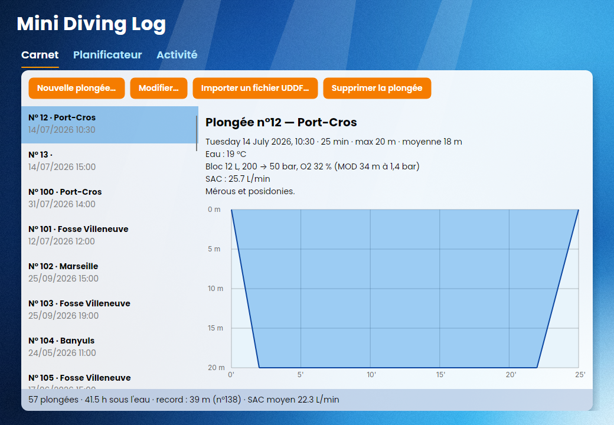
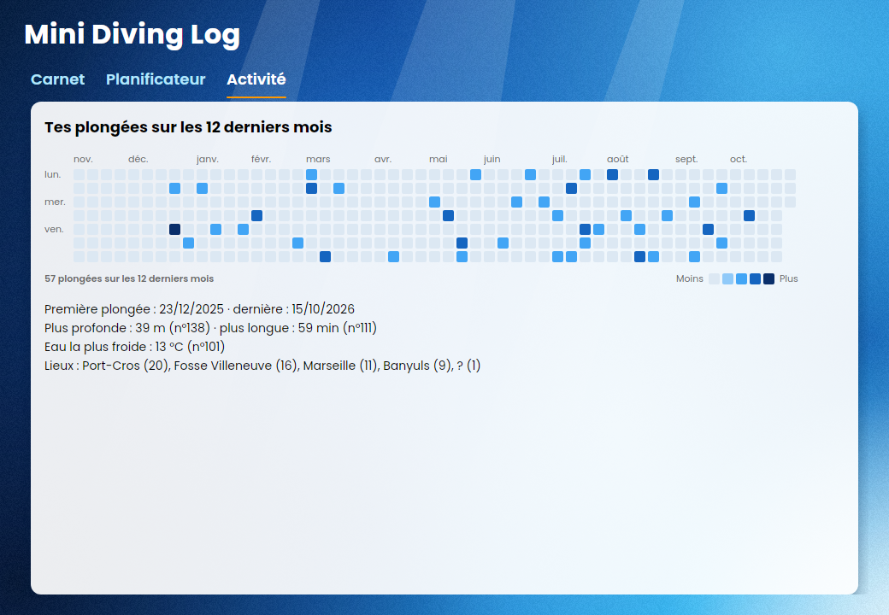

> Commencé : 2026

<div align="center">

# Mini Diving Log

Un carnet de plongée recodé de zéro en C#, pour apprendre le reverse engineering.


</div>

---

## Table des matières

1. [À propos du projet](#à-propos-du-projet)
   - [Construit avec](#construit-avec)
2. [Pour commencer](#pour-commencer)
   - [Prérequis](#prérequis)
   - [Installation](#installation)
3. [Utilisation](#utilisation)
4. [Organisation du code](#organisation-du-code)
5. [Feuille de route](#feuille-de-route)
6. [Contribuer](#contribuer)
7. [Licence](#licence)
8. [Contact](#contact)
9. [Remerciements](#remerciements)

---

## À propos du projet

Ce projet sert à apprendre le reverse engineering sur un vrai logiciel. On part d'une application
de plongée existante et fermée, **Diving Log 6** (Windows, .NET), on l'étudie sans son code source
avec [REA](https://github.com/morluto/rea), puis on recode une version à nous, étape par étape
et avec des tests.

On s'inspire du *comportement* observé, sans jamais copier le code ni les ressources
(logos, textes, images) de l'appli d'origine. Ce qu'on apprend en chemin est noté dans `docs/`.



**Ce que sait faire l'application :**
- Tenir un carnet de plongées (saisie, modification, suppression) enregistré dans SQLite
- Importer des fichiers UDDF exportés par Diving Log, Subsurface et d'autres
- Dessiner le profil de chaque plongée et signaler les remontées trop rapides
- Calculer le Nitrox (MOD, EAD, END) et la consommation (SAC)
- Planifier une décompression avec l'algorithme Bühlmann ZH-L16C et les facteurs de gradient
- Afficher l'activité sur 12 mois dans une grille façon GitHub, avec les records du carnet


### Construit avec

- [C# / .NET 10](https://dotnet.microsoft.com/)
- [Avalonia 12](https://avaloniaui.net/) pour l'interface graphique
- [Microsoft.Data.Sqlite](https://learn.microsoft.com/dotnet/standard/data/sqlite/) pour le stockage
- [xUnit](https://xunit.net/) pour les tests
- [REA](https://github.com/morluto/rea) pour l'analyse de l'application d'origine
- [Poppins](https://fonts.google.com/specimen/Poppins) pour la police

---

## Pour commencer

### Prérequis

- Le SDK .NET 10 (sur Arch Linux : `sudo pacman -S dotnet-sdk`)
- git

### Installation

1. Cloner le dépôt
```sh
git clone https://github.com/maximilien-ilic/reverse-engineering-scuba-diving.git
cd reverse-engineering-scuba-diving
```

2. Lancer les tests (les dépendances sont téléchargées automatiquement)
```sh
dotnet test
```

3. Lancer l'application
```sh
dotnet run --project src/MiniDivingLog.App
```

---

## Utilisation

L'application a trois onglets :

- **Carnet** : la liste des plongées, leurs détails et leur profil. On peut ajouter une plongée
  à la main, la modifier (double-clic), la supprimer ou importer un fichier UDDF.
- **Planificateur** : on entre la profondeur, la durée, le mélange et les facteurs de gradient,
  et on obtient les paliers, la limite sans palier et le profil prévu.
- **Activité** : la grille des plongées sur les 12 derniers mois et les records du carnet.



Le carnet est enregistré dans `~/.local/share/MiniDivingLog/carnet.db`.
Pour essayer sans rien saisir, importe `tests/MiniDivingLog.Tests/Exemples/carnet.uddf`.

Les calculs sont aussi utilisables directement depuis le code :

```csharp
// Profondeur maximale pour un Nitrox 32 à 1,4 bar de ppO2
double mod = Nitrox.Mod(0.32, 1.4);              // ≈ 33,8 m

// Plan de décompression : 40 m pendant 25 min, à l'air, GF 30/70
var plan = new Planificateur { GfBas = 0.30, GfHaut = 0.70 }.Planifier(40, 25, Melange.Air);
foreach (var palier in plan.Paliers)
    Console.WriteLine($"{palier.ProfondeurM} m : {palier.DureeMin} min");
```

---

## Organisation du code

- `docs/` : les notes d'analyse, une fiche par sujet (01 installateur, 02 architecture, 03 format UDDF).
- `src/MiniDivingLog.Core/` : le cœur, sans interface graphique.
  - `Carnet/` : le modèle de données (`Plongee`, `Bloc`, `Profil`).
  - `Calculs/` : Nitrox (MOD, EAD, END) et consommation (SAC).
  - `Calculs/Deco/` : le planificateur Bühlmann ZH-L16C avec facteurs de gradient.
  - `Import/` : la lecture des fichiers UDDF.
  - `Stockage/` : le carnet dans un fichier SQLite (`CarnetSqlite`).
  - `Statistiques/` : les records, les moyennes et la grille d'activité.
- `src/MiniDivingLog.App/` : l'interface graphique Avalonia (fond bleu nuancé, police Poppins
  embarquée dans `Assets/Fonts`).
- `tests/MiniDivingLog.Tests/` : les tests xUnit.

---

## Feuille de route

- [x] Analyser l'installateur et l'architecture de Diving Log avec REA
- [x] Modèle de données, calculs Nitrox et SAC
- [x] Stockage du carnet dans SQLite
- [x] Profil de plongée et statistiques
- [x] Planificateur de décompression Bühlmann ZH-L16C
- [x] Import UDDF, testé sur de vrais fichiers
- [x] Interface graphique Avalonia
- [x] Saisie et modification des plongées à la main
- [x] Grille d'activité façon GitHub
- [ ] Importer un vrai export UDDF de Diving Log
- [ ] Exporter le carnet en UDDF

---

## Contribuer

Les pull requests sont les bienvenues. Pour un gros changement, ouvre d'abord une issue.

---

## Licence

Le code n'a pas encore de licence. La police Poppins est distribuée sous licence
SIL Open Font License (voir `src/MiniDivingLog.App/Assets/Fonts/OFL.txt`).

---

## Contact

Maximilien Ilic — [LinkedIn](https://www.linkedin.com/in/maximilien-ilic/) — maximilien.ilic@gmail.com

---

## Remerciements

- [REA](https://github.com/morluto/rea), l'outil de reverse engineering utilisé pour étudier l'application d'origine
- Diving Log, l'application étudiée
- Le format [UDDF](https://www.streit.cc/extern/uddf_v321/en/index.html) (Universal Dive Data Format)
- Les fichiers de test UDDF du projet [Subsurface](https://subsurface-divelog.org/), utilisés pour vérifier l'import
